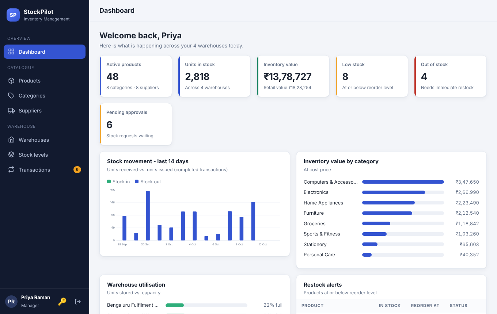
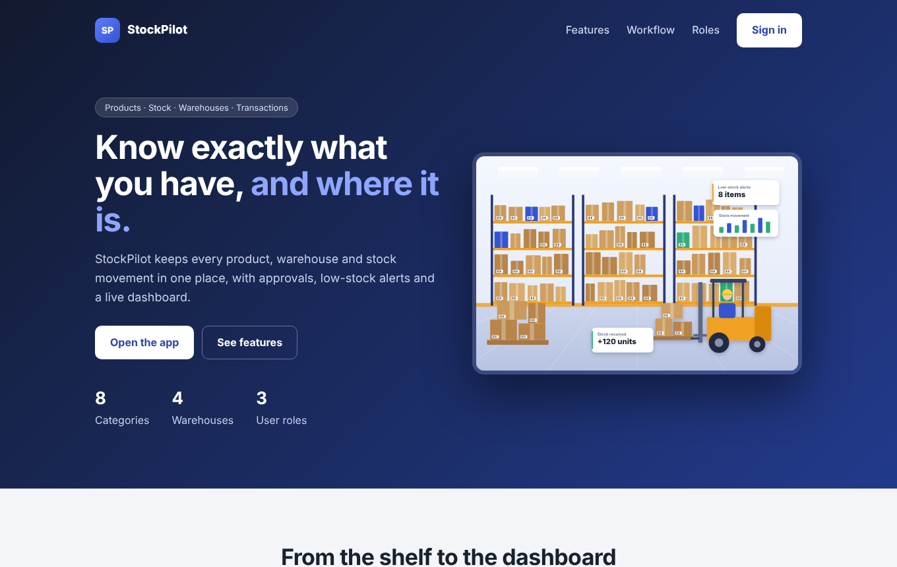
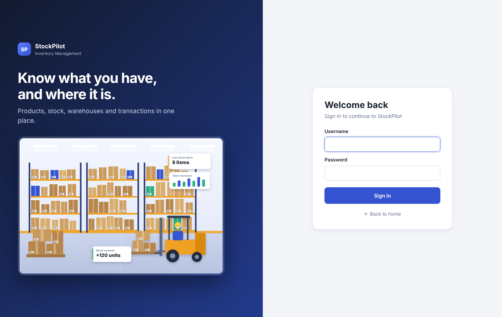
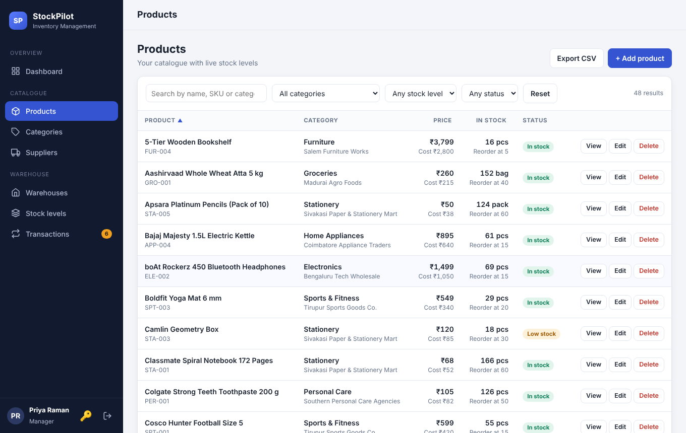
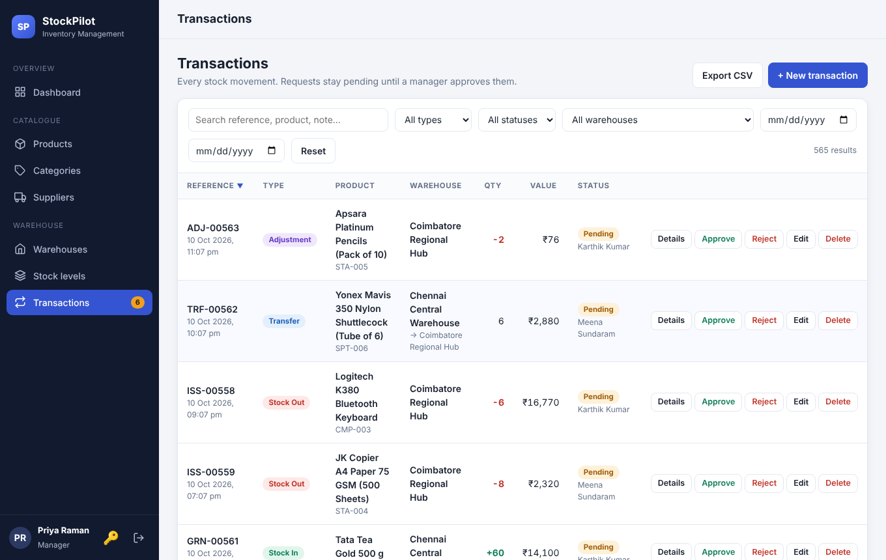

# StockPilot - Inventory Management System

A full-stack web application to manage **products, stock, warehouses and inventory transactions**, with role-based access, an approval workflow and a live dashboard.



| Landing page | Sign in |
|---|---|
|  |  |

| Products (search, filter, sort) | Transactions (approval workflow) |
|---|---|
|  |  |

## Tech stack
| Layer | Technology |
|---|---|
| Frontend | HTML, CSS, vanilla JavaScript (single-page app, no framework or build step) |
| Backend | Python 3, Flask (REST API, JSON) |
| Database | SQLite (schema in `database/schema.sql`) |
| Auth | Signed tokens (`itsdangerous`), hashed passwords (`werkzeug`) |
| Tests | `unittest` (10 API tests) |

## How to run
Requirement: **Python 3.9+** (check with `python --version`).

- **Windows:** double-click `run.bat`
- **Mac / Linux:** `./run.sh`

or manually:
```bash
python -m venv venv
venv\Scripts\activate            # Mac/Linux: source venv/bin/activate
pip install -r requirements.txt
python backend/app.py
```
Open **http://127.0.0.1:5000** (home page). The application is at **/app**.

The database is included. Reset it to fresh demo data any time with `python database/seed.py`.
Run the tests with `python -m unittest discover -s tests -v`.

## Demo accounts
| Role | Username | Password | Permissions |
|---|---|---|---|
| Admin | `admin` | `admin123` | Everything, plus user management |
| Manager | `manager` | `manager123` | Manage products, categories, suppliers, warehouses; approve or reject transactions |
| Staff | `staff` | `staff123` | View data, raise requests, edit/cancel their own pending requests |

## Features
- **Dashboard:** KPIs, inventory value, low and out-of-stock alerts, 14-day stock movement chart, value by category, warehouse utilisation, recent activity
- **CRUD:** products, categories, suppliers, warehouses, users, transactions
- **Search, filter, sort and pagination** on every list, plus CSV export
- **Workflow:** `PENDING -> COMPLETED | REJECTED | CANCELLED`. Stock only changes when a manager approves. Types: Stock In, Stock Out, Transfer, Adjustment
- **Business rules:** no negative stock, warehouse capacity limits, selling price >= cost price, unique SKU, records with history cannot be deleted (deactivate instead), completed transactions are immutable (audit trail)
- **Validation** in the browser and on the server, with field-level messages
- **Error handling:** consistent JSON errors (`{"error": ..., "details": {...}}`), toasts in the UI, rollback on failure
- **Security basics:** hashed passwords, token auth, role checks on every endpoint, output escaping against XSS, parameterised SQL

## Demo data
8 categories with 6 matching products each (48 products): Electronics, Computers & Accessories, Home Appliances, Groceries, Stationery, Personal Care, Furniture, Sports & Fitness. Plus 8 suppliers, 4 warehouses (Chennai, Coimbatore, Madurai, Bengaluru) and about 565 transactions. The transactions are generated through the same business rules the app uses, so stock always equals the transaction history (this is covered by a test). A few products are intentionally low or out of stock, and 6 requests are pending.

## Database design
```
categories 1---* products *---1 suppliers
products   1---* stock *---1 warehouses            (stock = quantity per product per warehouse)
products   1---* transactions *---1 warehouses     (+ optional to_warehouse for transfers)
users      1---* transactions                      (created_by, reviewed_by)
```
Tables: `users`, `categories`, `suppliers`, `warehouses`, `products`, `stock`, `transactions`.
Integrity is enforced in the database too (foreign keys, `CHECK` constraints, `UNIQUE` columns, indexes). A SQL dump is in `database/inventory_dump.sql`.

## Project structure
```
database/   schema.sql, seed.py, inventory.db, inventory_dump.sql
backend/    app.py (app + error handlers), config.py, db.py, auth.py, utils.py (validation, pagination),
            inventory_service.py (stock rules + workflow), routes/ (auth, users, masters, products, stock_tx, dashboard)
frontend/   landing.html, index.html, css/style.css, images/, js/ (api, ui, crud, dashboard, pages, app)
tests/      test_api.py
docs/       screenshots
```

## API summary
All endpoints are under `/api` and need `Authorization: Bearer <token>` (except login).

| Area | Endpoints |
|---|---|
| Auth | `POST /auth/login`, `GET /auth/me`, `POST /auth/change-password` |
| Master data | `GET/POST /products /categories /suppliers /warehouses`, `PUT/DELETE /<name>/:id` |
| Stock | `GET /stock`, `GET /products/:id` (stock per warehouse + history) |
| Transactions | `GET/POST /transactions`, `PUT/DELETE /transactions/:id`, `POST /transactions/:id/approve`, `/reject`, `/cancel` |
| Reports | `GET /dashboard` |
| Admin | `GET/POST /users`, `PUT/DELETE /users/:id` |

List endpoints accept `q`, `page`, `per_page`, `sort`, `order` and filters such as `category_id`, `stock_status`, `status`, `type`, `date_from`, `date_to`.

## Troubleshooting
- Port busy: `PORT=5001 python backend/app.py` (Windows: `set PORT=5001` first)
- `python` not found on Mac/Linux: use `python3`
- For real deployment set a strong `SECRET_KEY` environment variable and use a production server such as gunicorn or waitress.


## 🎥 Project Demo

Watch the video demonstration of my project:

▶️ [Click here to watch the video](https://github.com/priyadarshinianushree/-Inventory-management-/blob/main/inventory-management/StockPilot_Demo.mp4)
